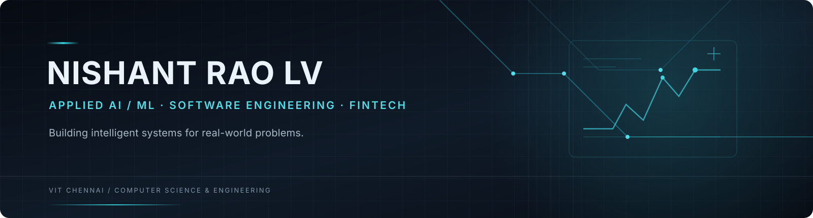

<!--
  Nishant Rao LV | Profile README
  Design: graphite / electric cyan / restrained technical editorial.
-->

 

### Engineering intelligent systems for problems that matter.

---

## 01 / Profile

I'm a **Computer Science undergraduate at VIT Chennai** focused on applied machine learning, intelligent software and data-driven products.

I enjoy working across the full engineering loop: understanding a problem, shaping the data, building and evaluating models, exposing capabilities through APIs, and delivering usable applications.

My strongest project interests sit at the intersection of **machine learning and real-world decision systems** — especially financial technology, risk modelling and explainable AI.

**Current focus:** ML fundamentals · model evaluation · backend systems · production-minded engineering.

## 02 / Selected engineering work

<table>
<tr>
<td width="50%" valign="top">

### [01 — NIVARA](https://github.com/nishantrao07/Nivara)

**Adaptive Financial Resilience & Credit Underwriting**

A decision-support platform designed to assess financial shortfall risk for gig-economy workers, explain risk drivers and estimate responsible credit capacity.

- Two-stage longitudinal resilience assessment
- XGBoost risk modelling and SHAP explanations
- What-if analysis for counterfactual risk exploration
- FastAPI backend with a React interface

**Stack**  
`Python` `XGBoost` `SHAP` `FastAPI` `React` `TypeScript`

</td>
<td width="50%" valign="top">

### [02 — ACOUSTIGUARD](https://github.com/nishantrao07/AcoustiGuard)

**Industrial Acoustic Anomaly Detection**

An audio-based diagnostic pipeline for rotating equipment and industrial valves, combining time-frequency features, temporal prediction and calibrated anomaly scoring.

- 64-band Log-Mel feature extraction
- Causal temporal convolutional network
- P95 prediction-error scoring
- Conformal calibration for anomaly thresholds

**Stack**  
`Python` `PyTorch` `TCN` `Signal Processing` `FastAPI`

Special Mention — Hacktronics 2.0, TechnoVIT'26

</td>
</tr>
<tr>
<td width="50%" valign="top">

### [03 — SHELFSENSE AI](https://github.com/nishantrao07/ShelfSenseAI)

**Autonomous Retail Shelf Sensing & Spatial Digital Twin**

A computer-vision system for shelf monitoring and planogram compliance, pairing object detection with temporal tracking and a 3D spatial interface.

- Unified YOLO11n product detector
- Real-time tracking and misplacement analysis
- Three.js digital twin
- FastAPI services and Supabase integration

**Stack**  
`Python` `YOLO` `FastAPI` `React` `Three.js` `Supabase`

</td>
<td width="50%" valign="top">

### [04 — AGRICARBON](https://github.com/nishantrao07/AgriCarbon)

**Precision Agriculture & Carbon Credit Platform**

A full-stack platform for farm insights, sustainability tracking, recommendations and carbon-credit workflows.

- Farm and soil-health dashboards
- Weather and recommendation workflows
- Carbon-credit wallet and impact reporting
- API-backed application with Supabase

**Stack**  
`Python` `FastAPI` `React` `TypeScript` `PostgreSQL`

</td>
</tr>
</table>

## 03 / Technical toolkit

| Domain | Technologies |
|---|---|
| **Languages** | Python · Java · C++ · C · SQL · JavaScript · TypeScript |
| **ML & Data** | XGBoost · PyTorch · Scikit-learn · Pandas · NumPy · SHAP · YOLO · OpenCV |
| **Backend** | FastAPI · Django · REST APIs |
| **Frontend** | React · TypeScript · Tailwind CSS |
| **Data stores** | MySQL · PostgreSQL · Supabase |
| **Engineering tools** | Git · GitHub · Linux · Docker |

## 04 / Recognition

**Special Mention — Hacktronics 2.0, TechnoVIT'26**  
Recognised for AcoustiGuard, an industrial acoustic anomaly detection system.

## 05 / What I'm building toward

- Strong foundations in machine learning, statistics and model evaluation.
- Reliable ML systems: reproducible experiments, clear APIs, testing and deployment.
- Applied AI for financial technology, risk intelligence and decision support.
- Deeper software engineering skills through deliberate project work and collaboration.

---

**INTERESTED IN BUILDING SOMETHING MEANINGFUL?**

Open to technical collaboration, research-oriented projects and internship opportunities in AI/ML and software engineering.

[GitHub](https://github.com/nishantrao07)

 

Build carefully. Evaluate honestly. Ship useful things.

